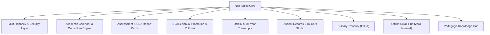
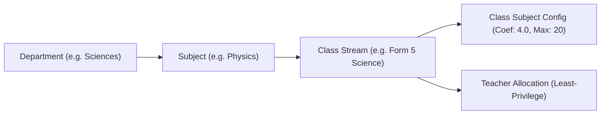
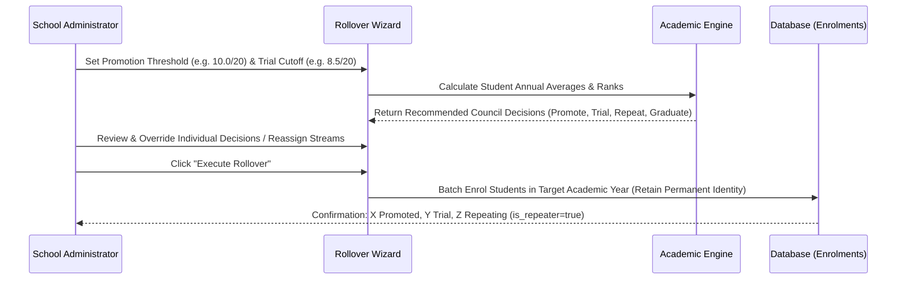

# Nsei Sukul: Comprehensive Institutional System Architecture & Functional Report

This document provides a complete technical, functional, and operational breakdown of the **Nsei Sukul** school management platform.

---

## 1. System Overview & Core Philosophy

Nsei Sukul is an institutional school operating system engineered specifically for secondary institutions in Cameroon (Anglophone, Francophone, and Bilingual subsystems). It bridges high-compliance ministerial mandates (MINESEC) with practical daily usability under bandwidth-constrained, intermittent, or offline campus conditions.

---

## 2. Multi-Tenancy & Security Architecture

### School Isolation & Subsystems
- **Tenant Partitioning**: Strict PostgreSQL Row Level Security (RLS) guarantees complete data isolation between schools. Every database query references `school_id`.
- **Subsystem Flexibility**: Supports `anglophone`, `francophone`, and `bilingual` institutions with customized terminology, grading scales, and report card layouts.
- **Custom Matricule Engine**: Automatic sequential matricule generation configurable per school format pattern (e.g. `{CODE}-{YEAR}-{SEQ:4}`). Built-in collision safety checks prevent duplicate matricules.
- **Resilient Network Layer**: Custom fetch adapter enforcing `cache: "no-store"` on Supabase REST queries to prevent Next.js Data Cache errors, paired with automatic transient socket retry (`ECONNRESET`, `ETIMEDOUT`).

### Role-Based Access Control (RBAC)
The system enforces least-privilege role boundaries:
1. **Superadmin / Platform Administrator**: Cross-school diagnostics, subscription management, tenant provisioning.
2. **Principal / Head of School**: Full institutional scope, academic year locking, council approvals, fee oversight.
3. **Head of Department (HOD)**: Departmental scope. Verification and lock of subject mark sheets across allocated teachers before publication.
4. **Class Master**: Class stream scope. Class list compilation, conduct remarks, attendance tallies, and council reports.
5. **Subject Teacher**: Assigned stream scope. Mark entry for allocated subjects only. Zero access to unallocated subjects.
6. **Bursar / Accounts Officer**: Financial ledger scope. Fee installments in FCFA, printable cash receipts, and debtor lists.

---

## 3. Academic Structure & Dynamic Curriculum

### 6-Sequence, 3-Term Calendar
- **Evaluation Sequences**: 6 official evaluation sequences (Sequences 1 to 6) organized strictly into 3 Terms (2 sequences per term).
- **Sequence Windows**: Principals open and close mark entry windows with automated date tracking.

### Department & Subject Hierarchy
- **Departments**: Administrative divisions (e.g. *Sciences & Mathematics*, *Languages & Letters*, *Humanities*, *Technical*).
- **Subject Catalog**: School-wide subject definitions with code, department assignment, and official default coefficients.
- **Dynamic Class Coefficients**: Class-level customization via `class_subjects`. A subject can carry coefficient 4 in Form 5 Science but coefficient 2 in Form 5 Arts.
- **Flexible Marking Scales**: Configurable `max_marks` per class subject (standard 20 for general subjects, 40/60/100 for technical practicals) with automatic normalization to `/20`.
- **Institutional Class Header**: Displays real-time curriculum metrics (Cycle 1 vs Cycle 2, total subjects assigned, cumulative coefficient sum, and assigned class master).

---

## 4. Assessment & Mark Entry Engine

- **Sequence Mark Sheets**: Mobile-friendly, high-contrast mark sheets for allocated teachers.
- **Status Flags**: Supports evaluated scores, Absent (`ABS`), and Medical/Approved Exemption (`EXC`).
- **Normalized Scores**: Database-level generated columns (`normalized_score_20`) automatically compute standard scores out of 20.
- **1-Click Excel / CSV Bulk Importer**:
  - Fuzzy header matching detects student matricule, name, and marks.
  - Pre-import validation preview flags invalid scores, missing students, or duplicate rows before database commit.
- **Departmental Verification Gate**: HODs inspect and approve sequence mark sheets before formal report card compilation.

---

## 5. MINESEC CBA Report Card Generation

- **Single-Page A4 Institutional Layout**: Designed for crisp laser printing with zero page overflow.
- **Competency-Based Approach (CBA)**: Compliant with Cameroon ministerial guidelines, featuring competency mastery indicators and domain-specific teacher appreciations (*Sciences*, *Arts*, *Technical*).
- **Automated Calculations**:
  - Subject averages, sequence totals, and weighted points.
  - Class-wide high, low, and average marks per subject.
  - Student overall weighted average and official class ranking.
- **Attendance & Discipline Summary**:
  - Unjustified absences (hours/days).
  - Punishments, conduct warnings, and council exclusions.
- **Bulk Engine**: Asynchronous generation of entire class batches with cached computations to eliminate rendering bottlenecks.
- **Anti-Fraud QR Verification**: Every report card prints with an encrypted cryptographic verification token linking to `/verify`.

---

## 6. 1-Click Annual Rollover & Promotion Wizard

Handles end-of-year student progression without requiring schools to re-admit returning students:

- **Customizable Thresholds**: Administrators configure direct promotion cutoff (default 10.00/20) and trial promotion cutoff (e.g. 8.00 to 9.99/20 for students admitted on trial / *admis à titre d'essai*).
- **Repeater Tracking**: Students below the trial cutoff are flagged (`is_repeater = true`) and placed in the same class level.
- **Terminal Class Detection**: Form 5 and Upper Sixth candidates passing exams are marked as `graduated`.
- **Permanent Student Identity**: Master profiles in `students` persist permanently. Only target-year records in `enrolments` are created.
- **Academic Year Auto-Seeding**: Administrators can create upcoming academic years directly from the wizard, auto-generating 3 terms, 6 sequences, and cloning class streams and coefficients.

---

## 7. Official Multi-Year Student Academic Transcript (*Relevé de Notes*)

A formal cumulative academic transcript covering a student's multi-year tenure:

- **Ministerial Heading**: Bilingual Republic of Cameroon / Ministry of Secondary Education header with national motto, school badge, and code.
- **Permanent Identification**: Full student demographic profile, matricule, birth certificate records, and date of first admission.
- **Chronological Progression Tables**:
  - Year-by-year cards showing academic session, class level, stream, and class master.
  - Full subject breakdown: Coefficient, Term 1 Mark, Term 2 Mark, Term 3 Mark, Annual Average, Weighted Points, and Ministerial Appreciation (*Très Bien*, *Bien*, *Assez Bien*, *Passable*, *Médiocre*, *Faible*).
  - Annual totals: Total coefficients, weighted points, annual general average, class rank, and class council decision.
- **Cumulative Grade Point Average (CGPA)**: Overall average out of 20 across all completed years with cumulative academic standing.
- **Authentication Block**: Official issuance date, verification notice, Dean of Studies certification line, and Principal signature and embossed seal placeholder.
- **Print Optimization**: Formatted with dedicated `@media print` rules for clean multi-page A4 printing or PDF export.

---

## 8. Student Directory, ID Cards & Registers

- **Centralized Directory**: Search by matricule, full name, gender, residence status (day / boarding), or class stream.
- **Status Lifecycle**: Active, Promoted, Repeated, Transferred, Withdrawn, Graduated, Dismissed.
- **CR80 Student ID Card Studio**:
  - Standard credit-card size (85.6mm x 54mm) laminated badge layout.
  - Student photo upload, birth details, matricule barcode, and emergency guardian contact.
  - Front and back printing layouts with anti-counterfeit QR code.
- **Official Class List & Student Register Generator**:
  - Generates MINESEC-compliant roll-call registers for inspectors.
  - Formatted with age distributions, gender ratios, repeaters count, and boarding breakdown.

---

## 9. Bursary & Fee Treasury (FCFA / XAF)

- **Tranche-Based Installments**: Registration, First Installment, Second Installment, PTA levies.
- **Printable Numbered Cash Receipts**:
  - Anti-tamper numbered receipts in FCFA.
  - Student details, class, fee balance remaining, cashier signature, and official stamp block.
- **Pre-Examination Debtor Rosters**: Instant filtering of students with outstanding fee balances before sequence exam access.
- **Daily Cash Collection Audits**: Real-time cashier logs grouped by payment date and payment method (Cash, MTN MoMo, Orange Money, Bank Deposit).

---

## 10. The Offline Sukul Hub Engine

Designed for rural campuses and areas prone to fiber cuts or electrical blackouts:

- **Local Wi-Fi Operation**: The Sukul Hub runs on a local micro-server or campus computer. Teachers enter marks and print report cards over local Wi-Fi without consuming mobile data.
- **Local LAN Discovery**: Automatic mDNS discovery (`sukul.local`) allows client laptops and phones to connect instantly.
- **Bidirectional Sync**:
  - Changes made offline are recorded in encrypted change logs.
  - Automatic reconciliation and conflict resolution once an internet uplink is detected.

---

## 11. Cameroon Pedagogic Knowledge Hub

Built-in reference library written specifically for Cameroon educators and administrators:
1. **MINESEC Inspection & Cahier de Texte Checklist**: Practical guide to passing departmental and regional pedagogic inspections.
2. **CBA Competency Appreciations Handbook**: 40 ready-to-use appreciations categorized by subject family and mastery level.
3. **Fixing Excel Class Council Calculation Errors**: Tutorial on migrating spreadsheet rosters into automated database grading.
4. **School Fee Collection & Debtor Management Guide**: Best practices for running a solvent school bursary with structured payment schedules.

---

## 12. Security, Audit Logs & Platform Health

- **Immutable Audit Trails**: Every assessment mark edit, fee collection, and student status modification is logged with user profile ID, IP, and timestamp.
- **Health Check Endpoints**: Automated ping and latency monitoring via `/api/v1/health` and `/api/v1/hub/lan-ping`.
- **Clean Modern Interface**: High-contrast, institutional typography, solid surfaces, zero blur effects, and strictly accessible layouts.
